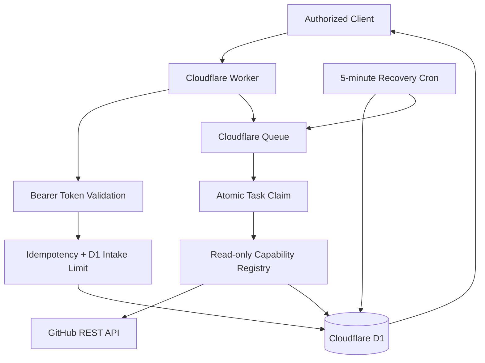

# Zubair AI Army

[](https://github.com/zopair/Zubair_AI_Army/actions/workflows/personal-agent-worker-tests.yml)
[](https://nodejs.org/)
[](#proof-of-concept--enterprise-customization-readiness)

**A modular portfolio of AI-enabled product concepts, with a Cloudflare Worker that executes a small, explicit allowlist of read-only repository operations.**

This repository contains multiple product tracks at different levels of maturity. The descriptions below distinguish implemented components from planned or incomplete work; a product label or roadmap entry is not evidence of a finished agent or production service.

## Business problem

AI product experiments often become fragmented across repositories, scripts, and workflow prototypes. Without clear boundaries, repeatable validation, and a visible execution contract, it is difficult to identify what is operational, what is reusable, and what still needs engineering.

## Solution

Zubair AI Army is a portfolio workspace for consolidating product experiments and reusable automation components. Its current executable slice is a Cloudflare Worker that validates an allowlisted operation, stores it in D1, queues execution, reads repository metadata through the GitHub API, and persists a bounded JSON result.

## Current architecture



**Execution boundary:** the executor accepts only `repository_inventory` and `repository_documentation_audit`. Both operations read repository metadata and tracked paths; they do not run user-supplied shell commands, modify repositories, or invoke an LLM. Each task is limited to 50 GitHub requests, runs alone in a Queue invocation, and stops on GitHub rate limits; only transient failures receive bounded retries. New valid task submissions are capped at 20 per single-owner 60-second window.

## Portfolio status

| Track | Intended direction | Verified status |
|---|---|---|
| V1 — Production Radar | Repository and API security analysis | Concept area; not verified as a complete product |
| V2 — Intelligent Commerce | Commerce and pricing automation | Concept area; not verified as a complete product |
| V3 — Sovereign Core | Shared agent and platform foundations | Partial experiments; requires component-level audit |
| V4 — Elite Pro Builder | AI-enabled professional services | Incomplete prototype; do not treat as launch-ready |
| Personal Agent Worker | Task intake, D1 persistence, queue, allowlisted repository analysis | Implemented on main; CI verified; live Cloudflare deployment remains blocked by unconfigured D1/Queue resources |

## Quick start — Personal Agent Worker

### Prerequisites

- Cloudflare account with Workers, D1, and Queues enabled
- Node.js 22+
- Wrangler CLI
- A GitHub token or GitHub App token with read-only `Contents` access to the configured repository

### Configure

1. Create a D1 database named `personal-agent-db` and a Queue named `personal-agent-tasks`.
2. Replace the `database_id` placeholder in `personal-agent/worker/wrangler.toml` with the D1 database ID.
3. From the repository root, run the strict configuration preflight:

```bash
python scripts/ci/preflight_worker_config.py
```

4. Apply the ordered migrations (including task idempotency, intake limiting and error codes):

```bash
cd personal-agent/worker
wrangler d1 migrations apply personal-agent-db --remote
```

5. Configure secrets without committing them:

```bash
wrangler secret put API_TOKEN
wrangler secret put GITHUB_TOKEN
```

The non-secret `GITHUB_REPOSITORY` setting is declared in `wrangler.toml`. The GitHub token is used only for read-only repository metadata and Git tree requests.

### Run locally and deploy

```bash
cd personal-agent/worker
wrangler dev
# Deploy only after the D1 binding, queue, and secrets are configured:
wrangler deploy
```

### API contract

- `GET /health` — unauthenticated liveness response.
- `POST /api/tasks` — accepts only `repository_inventory` or `repository_documentation_audit`, requires `Authorization: Bearer <API_TOKEN>`, and rejects every other operation.
- Optional `Idempotency-Key` makes ordinary client retries return the original task instead of enqueueing duplicate work.
- New valid submissions are limited to 20 per fixed 60-second single-owner window; excess requests receive HTTP `429`.
- `GET /api/tasks/{task_id}` — returns status, result, human-readable error and stable `error_code` where present.

Do not expose this prototype publicly until tenant identity, per-IP abuse controls, operational monitoring and a live deployment test have been reviewed.

## Development and tests

The worker's focused tests use Node.js built-ins and Python's standard library; no paid service or third-party test framework is required.

```bash
cd personal-agent/worker
npm test
python -m unittest discover -s tests -v
```

The tests cover bearer-token matching, allowlist enforcement, GitHub API request budgets and redirect policy, queue claims and stale recovery, rate-limit handling, repository inventory and documentation audit behavior, configuration preflight, and all D1 schema migrations. They do not replace a live Cloudflare deployment test.

## Proof of Concept & Enterprise Customization Readiness

| Area | Current status |
|---|---|
| Worker authentication | Fixed-work byte comparison helper; JavaScript runtime does not guarantee formal constant-time execution |
| Task intake | Implemented with strict operation allowlist and D1 persistence |
| Queue execution | Atomic task claim, one message per invocation, bounded transient retries and five-minute stale recovery Cron |
| Supported operations | Repository inventory and documentation/CI evidence audit; read-only |
| Result lifecycle | Results, terminal status and stable error codes persisted in D1 and returned by task lookup |
| Arbitrary shell / write operations | Explicitly unsupported |
| LLM execution | Not connected to a deployed inference endpoint; provider router exists separately |
| Rate limiting and abuse protection | D1-backed 20-new-task / 60-second global single-owner cap; no per-IP or tenant throttling |
| Enterprise identity / tenant isolation | Not implemented |
| Product tracks V1–V4 | Mixed maturity; require separate audits and acceptance criteria |

**Release posture:** Proof of Concept / MVP. The worker can execute bounded read-only repository tasks with idempotent intake, queue recovery and stable diagnostics. It is not a general-purpose autonomous agent; live D1/Queue/Cron deployment, tenant isolation, per-IP abuse controls and operational monitoring remain unverified.

## Roadmap

- [x] Implement a fixed read-only capability registry and reject unregistered operations.
- [x] Add D1 idempotency, a bounded single-owner intake rate, atomic queue claims and scheduled stale-task recovery.
- [x] Persist terminal diagnostics and align request budgets with Workers Free limits.
- [ ] Provision D1/Queue resources, configure secrets, apply migrations and run a controlled live smoke test.
- [ ] Add a human approval gate only when a concrete write-capable capability is proposed.
- [ ] Audit V1–V4 independently before describing them as launch-ready.
- [ ] Define a clear open-source or proprietary license before external redistribution.

## Intellectual Property & Authorship

Project authorship and attribution: **Aly Hussein Zopair (علي حسين زبير ALY HUSSEIN ZOPAIR)**.

No root-level `LICENSE` file was found in the repository at the time of this update. Redistribution and third-party contribution terms therefore remain unspecified; add an explicit license before external distribution. This authorship notice does not replace a legal license or transfer third-party rights.

## Portfolio samples

These are clearly labelled demonstration assets prepared for an Upwork application; they are not represented as past client work.

- [Sample 1 — Insurance Advisory (EN/AR)](./sample-1-insurance-advisory/)
- [Sample 2 — Arabic-first Business (AR/EN)](./sample-2-arabic-first/)
- [Documentation and handover](./docs/)
- [Project report](./docs/REPORT.md)
