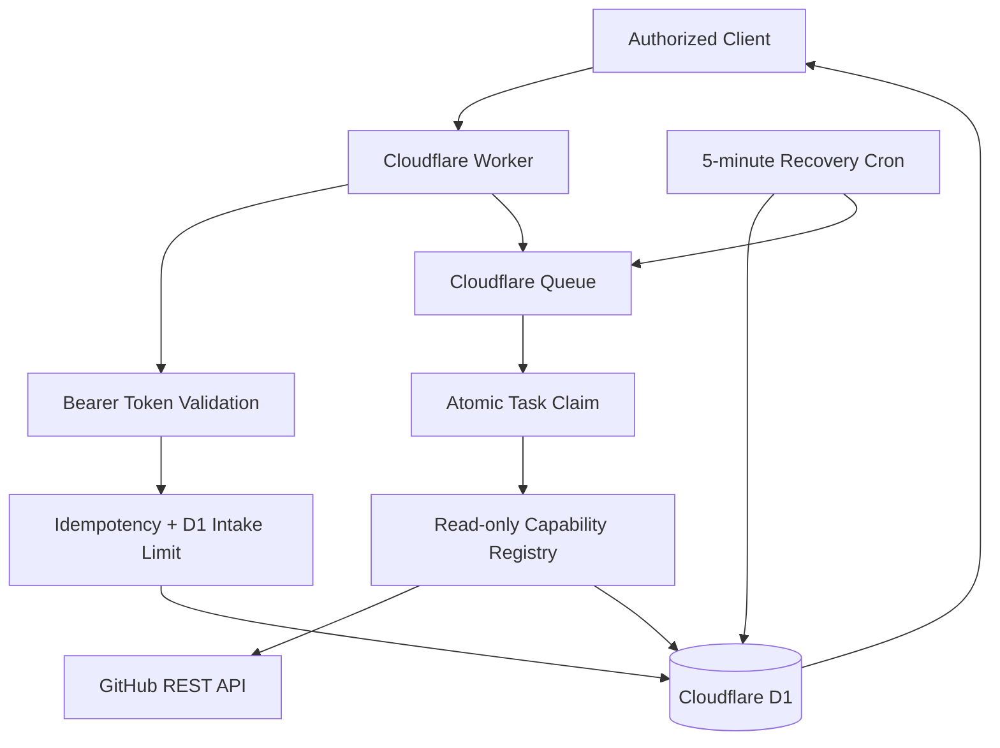

# Zubair AI Army

[](https://github.com/zopair/Zubair_AI_Army/actions/workflows/personal-agent-worker-tests.yml)
[](https://nodejs.org/)
[](#proof-of-concept--enterprise-customization-readiness)

**A multi-track engineering portfolio with a bounded Cloudflare Worker for read-only GitHub repository operations and a separate Arabic-first Next.js prototype.**

[Source repository](https://github.com/zopair/Zubair_AI_Army)

> **Project status:** Proof of Concept / MVP. This repository contains several product tracks at different maturity levels. The Personal Agent Worker has automated tests, but its live D1/Queue resources and deployed endpoint are not configured. V4 is a deterministic rule-based profile-review prototype, not an AI-powered or payment-enabled service. Do not interpret portfolio concepts, workflow names, or roadmap items as completed products.

## 1. Project Overview & Problem Statement

AI product experiments can become fragmented across separate repositories, scripts, and workflow prototypes. Without a clear execution contract and repeatable verification, reviewers cannot easily distinguish implemented functionality from concepts, simulations, and deployment-dependent work.

Zubair AI Army is a portfolio workspace that consolidates several product experiments and reusable engineering components. Its most verifiable executable components on the default branch are:

- **Personal Agent Worker:** an authenticated Cloudflare Worker that accepts two fixed read-only repository operations, stores tasks in D1, queues execution, reads repository metadata and Git tree information from GitHub, and persists bounded results.
- **V4 Elite Builder:** an Arabic-first Next.js application that reviews a professional headline and summary using deterministic rules and transparent disclaimers.
- **Portfolio samples:** static demonstration pages for insurance advisory, Arabic-first business, and a Rakez performance command center.
- **Additional research tracks:** V1–V3 and other experiments at mixed maturity; each requires its own implementation and deployment audit.

### Personal Agent Worker architecture



**Worker execution boundary:** only `repository_inventory` and `repository_documentation_audit` are accepted. Both operations are read-only. They do not run user-supplied shell commands, modify repositories, read repository file contents, or invoke an LLM. Each task has a 50-request GitHub API budget, executes alone in a Queue invocation, and stops on rate limits. New valid submissions are capped at 20 per single-owner 60-second window.

## 2. Tech Stack & Versions

Versions are taken from repository manifests, workflows, and Dockerfile. Ranges are shown as declared; no exact patch version is claimed when it is not pinned.

| Component | Technology | Declared / CI version |
|---|---|---|
| Personal Agent Worker | TypeScript / JavaScript ES modules | Cloudflare Workers runtime; `compatibility_date = 2026-10-30` |
| Worker test runtime | Node.js | 22; tests use Node's built-in test runner and `--experimental-strip-types` |
| Worker persistence | Cloudflare D1 / SQLite SQL migrations | D1 binding; five ordered SQL migrations |
| Worker queue | Cloudflare Queues | One message per invocation (`max_batch_size = 1`) |
| Scheduled recovery | Cloudflare Cron Triggers | `*/5 * * * *` |
| GitHub integration | GitHub REST API | API version `2022-11-28`; read-only GET requests |
| Worker preflight / migration tests | Python | Python 3.11+; CI also uses Python 3.12 for repository preflight |
| V4 application | Next.js | `^16.1.1` |
| V4 UI | React / React DOM | `^19.2.0` |
| V4 language tooling | TypeScript | `^5.9.3` |
| V4 type packages | `@types/node`, `@types/react`, `@types/react-dom` | `^22.15.0`, `^19.0.0`, `^19.0.0` |
| V4 runtime | Node.js | `>=20.9.0` declared; CI and Docker use Node.js 22 |
| Container build | Docker | `node:22-alpine` stages; Next.js standalone output |
| CI | GitHub Actions | Node.js 22, Python 3.11 / 3.12 |

The Worker has no third-party npm runtime dependencies in `personal-agent/worker/package.json`. Wrangler is used as a deployment/local-development CLI but is not pinned as a project package. The V4 project declares its dependencies in `v4_elite_builder/package.json`; no V4-specific lockfile is present in that directory.

## 3. Prerequisites & Dependencies

### For the automated Worker tests

- Node.js 22 or newer.
- Python 3.11 or newer.
- Git.
- No Cloudflare account, API token, paid service, or external test framework is required for the repository's mock-based tests and SQLite migration tests.

### For the V4 application

- Node.js 20.9 or newer (Node.js 22 is the tested CI/container version).
- npm.
- A modern browser.

### For optional Worker deployment

- A Cloudflare account with Workers, D1, and Queues configured.
- Wrangler CLI.
- A D1 database and Queue matching `personal-agent/worker/wrangler.toml`.
- Worker secrets `API_TOKEN` and `GITHUB_TOKEN`.
- A GitHub token restricted to the read permissions required for repository metadata and Git tree requests.

**Deployment is not currently ready:** the checked-in `database_id` is intentionally a placeholder. The strict preflight rejects it until a real D1 database ID is configured. The repository does not claim to have a live Worker deployment.

## 4. Installation & Local Setup (Step-by-Step)

### A. Clone the repository

```bash
git clone https://github.com/zopair/Zubair_AI_Army.git
cd Zubair_AI_Army
```

### B. Run Personal Agent Worker tests

```bash
cd personal-agent/worker
npm test
python -m unittest discover -s tests -v
cd ../..
```

These tests use Node's built-in test runner and Python's standard library. The Worker code is tested with mocked Cloudflare bindings and mocked GitHub responses; this does not deploy a Worker or prove live D1/Queue connectivity.

### C. Validate the checked-in Worker template

From the repository root:

```bash
python scripts/ci/preflight_worker_config.py --allow-placeholders
```

This checks the configuration structure while explicitly allowing the placeholder database ID. It is a template check only, not deployment approval.

The strict deployment check is:

```bash
python scripts/ci/preflight_worker_config.py
```

It is expected to fail until `database_id` is replaced with the actual D1 UUID and the deployment resources are configured.

### D. Run V4 Elite Builder locally

```bash
cd v4_elite_builder
npm install --no-audit --no-fund
npm run dev
```

Open the local URL printed by Next.js (normally `http://localhost:3000`).

Run V4 checks:

```bash
node --test tests/*.test.mjs
npm run typecheck
npm run build
```

### E. Optional Docker build for V4

The root Dockerfile builds the V4 Next.js application using Node.js 22 Alpine and the Next.js standalone output:

```bash
docker build -t zubair-ai-army-v4 .
docker run --rm -p 3000:3000 zubair-ai-army-v4
```

This container target is V4 only; it does not deploy the Cloudflare Worker, create D1/Queue resources, or activate the other portfolio tracks.

## 5. Environment Variables

### Personal Agent Worker

| Name | Type | Purpose | Safe example / configuration |
|---|---|---|---|
| `API_TOKEN` | Worker secret | Bearer token required for protected task routes | Set privately with `wrangler secret put API_TOKEN` |
| `GITHUB_TOKEN` | Worker secret | Read-only GitHub repository metadata and Git tree access | Set privately with `wrangler secret put GITHUB_TOKEN` |
| `GITHUB_REPOSITORY` | Non-secret Worker variable | Repository in `owner/name` format | `zopair/Zubair_AI_Army` (already declared in `wrangler.toml`) |

Cloudflare bindings, not environment variables:

- `DB`: D1 database binding.
- `TASK_QUEUE`: Queue producer binding.

The D1 `database_id` is a configuration value in `wrangler.toml`, not a secret or environment variable. Replace the placeholder only in a deliberate deployment configuration. Never commit real tokens or place them in browser-delivered code.

### V4 Elite Builder

No environment variables are required by the current V4 application. It does not connect to an external LLM, LinkedIn OAuth, a payment provider, or a persistent user database.

### Docker runtime defaults

The Dockerfile sets `NODE_ENV=production`, `NEXT_TELEMETRY_DISABLED=1`, `PORT=3000`, and `HOSTNAME=0.0.0.0` for the V4 standalone container.

## 6. Usage Guide & Core Features

### A. Personal Agent Worker API

All routes other than `GET /health` require:

```http
Authorization: Bearer <API_TOKEN>
```

**Health check**

```http
GET /health
```

This is a liveness response only; it does not prove D1, Queue, GitHub credentials, or deployment health.

**Submit a task**

```http
POST /api/tasks
Content-Type: application/json

{ "operation": "repository_inventory" }
```

The only accepted operations are:

- `repository_inventory`
- `repository_documentation_audit`

A new task returns HTTP `202` with a task ID and queued status. An optional `Idempotency-Key` (8–128 visible ASCII characters) makes retries safe. Reusing a key for another operation returns HTTP `409`. New valid submissions are limited to 20 per fixed 60-second single-owner window; excess requests receive HTTP `429`.

**Read task status**

```http
GET /api/tasks/<uuid>
```

The response includes persisted status, result, error, and stable `error_code` where available. Clients should branch on `error_code`, not parse human-readable error messages.

### B. V4 Elite Builder

V4 provides:

- Arabic-first, right-to-left responsive interface.
- Profile headline and summary review form.
- Server-side validation and whitespace normalization.
- Deterministic, rule-based recommendations.
- Clear disclosure that recommendations are not generated by an AI model.
- Disabled payment surface.

API route: `POST /api/linkedin-optimize`

Example request:

```json
{
  "headline": "Senior Software Engineer",
  "summary": "Builds products. Delivers measurable outcomes."
}
```

Limits: request body up to 9,000 characters, headline up to 180 characters, and summary up to 4,000 characters after normalization.

### C. Static portfolio samples

- `sample-1-insurance-advisory/`: insurance advisory demonstration.
- `sample-2-arabic-first/`: Arabic-first business sample.
- `sample-3-rakez-performance-command-center/`: Rakez performance dashboard sample.

The Pages workflow assembles the Arabic-first sample at the Pages root and the Rakez sample under `/rakez/`.

### D. Important workflow distinction

`.github/workflows/personal-agent.yml` is a manual `workflow_dispatch` workflow that stores supplied task text as data and uploads a short-retention artifact. It does **not** execute the task, call an LLM, dispatch the Cloudflare Queue, or act as a Worker completion callback.

## 7. Live Demo & Screenshots

### GitHub Pages deployment target

The `rakez-dashboard-pages.yml` workflow assembles and deploys the static portfolio previews. Expected paths from the repository's GitHub Pages project configuration are:

- **Arabic-first sample:** [https://zopair.github.io/Zubair_AI_Army/](https://zopair.github.io/Zubair_AI_Army/)
- **Rakez dashboard sample:** [https://zopair.github.io/Zubair_AI_Army/rakez/](https://zopair.github.io/Zubair_AI_Army/rakez/)

These are deployment targets configured by the workflow; check the latest [Pages workflow run](.github/workflows/rakez-dashboard-pages.yml) before treating them as currently available live demos.

The V4 Next.js app and Personal Agent Worker are local/deployment-dependent components, not represented by the Pages static site.

### Screenshots

No dedicated screenshot files for the main V4 app or Worker API are currently tracked in the audited repository. Add genuine captures after a reproducible local run:

<!--  -->
<!--  -->
<!--  -->

## 8. Testing & Verification

### Personal Agent Worker

```bash
cd personal-agent/worker
npm test
python -m unittest discover -s tests -v
```

Coverage includes:

- Bearer-token validation and protected route behavior.
- Allowlist enforcement and malformed/oversized request rejection.
- Idempotency behavior and task lifecycle.
- Queue claim and stale-task recovery behavior.
- GitHub API request budget, redirect handling, and rate-limit classification.
- Repository inventory and documentation-audit output.
- D1 migration chain applied to SQLite.
- Worker configuration preflight rules.

### V4 application

```bash
cd v4_elite_builder
node --test tests/*.test.mjs
npm run typecheck
npm run build
```

The contract tests cover malformed input, non-object payloads, blank fields, request-size and field limits, whitespace normalization, and the explicit rule-based response disclaimer.

### CI workflows

- [Personal Agent Worker Tests](.github/workflows/personal-agent-worker-tests.yml): Node.js 22 tests and Python 3.11 migration/configuration tests.
- [Zubair AI Army CI](.github/workflows/ci.yml): Worker tests, V4 contract tests/type-check/build, and repository preflight.
- [Rakez Pages deployment](.github/workflows/rakez-dashboard-pages.yml): static preview assembly and GitHub Pages deployment.

A green unit/contract-test workflow does not prove a live Cloudflare deployment or third-party service integration.

## Proof of Concept & Enterprise Customization Readiness

| Area | Current status |
|---|---|
| Worker authentication | Bearer-token check implemented; JavaScript runtime does not guarantee formal constant-time execution |
| Task intake | Implemented with a strict two-operation allowlist and D1 persistence |
| Queue execution | Atomic task claim, one message per invocation, bounded retries, and five-minute stale recovery Cron |
| Supported Worker operations | Repository inventory and documentation/CI evidence audit; read-only |
| Result lifecycle | Persisted status, results, and stable error codes |
| Arbitrary shell / write operations | Explicitly unsupported |
| LLM execution | Not connected to a deployed inference endpoint |
| Live Worker deployment | Not verified; D1 ID remains a placeholder and resources/secrets are not configured |
| V4 profile review | Implemented with deterministic rules; no AI model or LinkedIn account integration |
| V4 payments | Disabled |
| Enterprise identity / tenant isolation | Not implemented |
| Product tracks V1–V4 | Mixed maturity; require separate audits |

**Release posture:** PoC / MVP. The Worker has a bounded, read-only execution path with tests and diagnostics. It is not a general-purpose autonomous agent. Live Cloudflare resources, tenant isolation, per-IP abuse controls, and production monitoring remain unverified.

## Roadmap

- [x] Implement a fixed read-only capability registry and reject unregistered operations.
- [x] Add D1 idempotency, a bounded single-owner intake rate, atomic queue claims, and scheduled stale-task recovery.
- [x] Persist terminal diagnostics and align request budgets with Workers Free limits.
- [ ] Provision D1/Queue resources, configure secrets, apply migrations, and run a controlled live smoke test.
- [ ] Add a human approval gate before introducing any write-capable capability.
- [ ] Audit V1–V4 independently before describing them as launch-ready.
- [ ] Define an explicit repository license before external redistribution.

## Intellectual Property & Authorship

Project authorship and attribution: **Aly Hussein Zopair (علي حسين زبير ALY HUSSEIN ZOPAIR)**.

No root-level `LICENSE` file was found on the audited default branch at the time of this review. Redistribution and third-party contribution terms therefore remain unspecified; add an explicit license before external distribution. This authorship notice does not replace a legal license or transfer third-party rights.

## Portfolio Samples

These are demonstration assets prepared for portfolio review; they are not represented as past client work.

- [Sample 1 — Insurance Advisory (EN/AR)](./sample-1-insurance-advisory/)
- [Sample 2 — Arabic-first Business (AR/EN)](./sample-2-arabic-first/)
- [Sample 3 — Rakez Performance Command Center](./sample-3-rakez-performance-command-center/)
- [Documentation and handover](./docs/)
- [Project report](./docs/REPORT.md)
