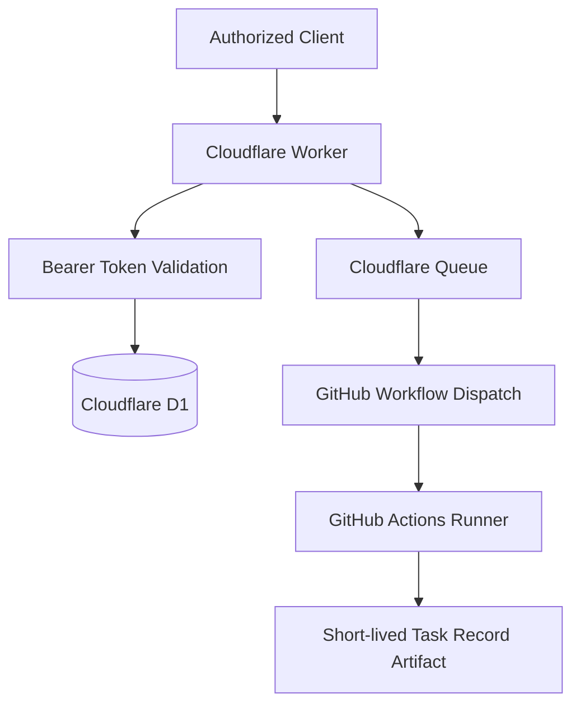

# Zubair AI Army

[](https://github.com/zopair/Zubair_AI_Army/actions/workflows/personal-agent-worker-tests.yml)
[](https://nodejs.org/)
[](#proof-of-concept--enterprise-customization-readiness)

**A modular portfolio of AI-enabled product concepts, with an implemented Cloudflare task-intake and GitHub Actions dispatch prototype.**

This repository contains multiple product tracks at different levels of maturity. The descriptions below distinguish implemented components from planned or incomplete work; a product label or roadmap entry is not evidence of a finished agent or production service.

## Business problem

AI product experiments often become fragmented across repositories, scripts, and workflow prototypes. Without clear boundaries, repeatable validation, and a visible execution contract, it is difficult to identify what is operational, what is reusable, and what still needs engineering.

## Solution

Zubair AI Army is a portfolio workspace for consolidating product experiments and reusable automation components. Its current executable slice is a Cloudflare Worker that accepts bounded task requests, persists task metadata in D1, queues dispatch, and triggers a GitHub Actions workflow.

## Current architecture



**Important execution boundary:** the current GitHub Actions workflow stores the submitted task text as data and uploads a short-lived artifact. It does **not** execute arbitrary commands, call an LLM, or complete general-purpose AI tasks. The worker is a task-intake and dispatch scaffold, not yet a finished autonomous agent.

## Portfolio status

| Track | Intended direction | Verified status |
|---|---|---|
| V1 — Production Radar | Repository and API security analysis | Concept area; not verified as a complete product |
| V2 — Intelligent Commerce | Commerce and pricing automation | Concept area; not verified as a complete product |
| V3 — Sovereign Core | Shared agent and platform foundations | Partial experiments; requires component-level audit |
| V4 — Elite Pro Builder | AI-enabled professional services | Incomplete prototype; do not treat as launch-ready |
| Personal Agent Worker | Task intake, D1 persistence, queue, GitHub dispatch | Source implementation present; tests and migration included in this branch |

## Quick start — Personal Agent Worker

### Prerequisites

- Cloudflare account with Workers, D1, and Queues enabled
- Node.js 22+
- Wrangler CLI
- A GitHub token or GitHub App token with permission to dispatch the configured workflow

### Configure

1. Create a D1 database named `personal-agent-db` and a Queue named `personal-agent-tasks`.
2. Replace the `database_id` placeholder in `personal-agent/worker/wrangler.toml` with the D1 database ID.
3. Apply the migration:

```bash
cd personal-agent/worker
wrangler d1 migrations apply personal-agent-db --remote
```

4. Configure secrets without committing them:

```bash
wrangler secret put API_TOKEN
wrangler secret put GITHUB_TOKEN
```

The non-secret `GITHUB_REPOSITORY` setting is declared in `wrangler.toml`. Verify that the GitHub token can dispatch `.github/workflows/personal-agent.yml`.

### Run locally and deploy

```bash
cd personal-agent/worker
wrangler dev
# Deploy only after the D1 binding, queue, and secrets are configured:
wrangler deploy
```

### API contract

- `GET /health` — unauthenticated liveness response.
- `POST /api/tasks` — accepts JSON `{"task":"..."}`, requires `Authorization: Bearer <API_TOKEN>`, and enforces a 1–4000 character task limit.
- `GET /api/tasks/{task_id}` — returns the persisted task record and requires the same bearer token.

Do not expose this prototype publicly without rate limiting, abuse controls, an operational error policy, and a reviewed authorization model.

## Development and tests

The worker's focused tests use Node.js built-ins and Python's standard library; no paid service or third-party test framework is required.

```bash
cd personal-agent/worker
npm test
python -m unittest discover -s tests -v
```

The tests cover bearer-token matching and the D1 schema migration. They do not replace Cloudflare deployment tests or a live GitHub dispatch integration test.

## Proof of Concept & Enterprise Customization Readiness


| Area | Current status |
|---|---|
| Worker authentication | Fixed-work byte comparison helper; JavaScript runtime does not guarantee formal constant-time execution |
| Task intake | Implemented with request validation and D1 persistence |
| Queue dispatch | Implemented through Cloudflare Queue and GitHub workflow dispatch |
| Task execution | Not implemented; workflow currently records task text only |
| Durable result lifecycle | Partial; completion callback and terminal-state updates remain to be implemented |
| Rate limiting and abuse protection | Not implemented |
| Enterprise identity / tenant isolation | Not implemented |
| Product tracks V1–V4 | Mixed maturity; require separate audits and acceptance criteria |

**Release posture:** Proof of Concept / MVP. Do not market the repository as a complete multi-agent system or deploy it as a production autonomous executor until the execution engine, authorization, rate limits, durable task lifecycle, observability, and end-to-end tests are implemented.

## Roadmap

- [ ] Implement an allowlisted task execution contract with explicit approval gates.
- [ ] Add worker-to-runner completion callbacks and durable terminal task states.
- [ ] Add bounded retries, rate limiting, idempotency, and operational metrics.
- [ ] Audit each V1–V4 track independently before describing it as launch-ready.
- [ ] Define a clear open-source or proprietary license before external redistribution.

## Intellectual Property & Authorship

Project authorship and attribution: **Aly Hussein Zopair (علي حسين زبير ALY HUSSEIN ZOPAIR)**.

No root-level `LICENSE` file was found in the repository at the time of this update. Redistribution and third-party contribution terms therefore remain unspecified; add an explicit license before external distribution. This authorship notice does not replace a legal license or transfer third-party rights.

## Portfolio samples

These are clearly labelled demonstration assets prepared for an Upwork application; they are not represented as past client work.

- [Sample 1 — Insurance Advisory (EN/AR)](./sample-1-insurance-advisory/)
- [Sample 2 — Arabic-first Business (AR/EN)](./sample-2-arabic-first/)
- [Documentation and handover](./docs/)
- [Project report](./docs/REPORT.md)
