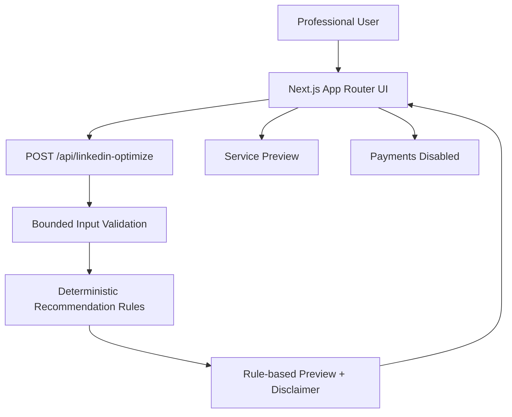

# Zubair Elite Builder — V4

[](https://github.com/zopair/Zubair_AI_Army/actions/workflows/ci.yml)
[](#proof-of-concept--enterprise-customization-readiness)

**Arabic-first professional profile improvement prototype with deterministic, rule-based feedback.**

## Business problem

Professionals often need a clearer headline and summary before applying for roles or presenting their services. The first version should provide useful, transparent feedback without pretending to be an AI service or charging for capabilities that are not implemented.

## Current solution

V4 provides:
- An Arabic-first, right-to-left responsive interface.
- A bounded profile review form for a headline and summary.
- A server-side API that validates input, normalizes whitespace, and returns deterministic writing recommendations.
- A small set of clearly labelled service previews.
- A disabled payment surface; no payment provider or transaction processing is configured.

## Architecture



No external LLM, account integration, payment gateway, or user-data persistence is connected in this PoC.

## Quick start

Requirements: Node.js 22 or later.

```bash
cd v4_elite_builder
npm install --no-audit --no-fund
npm run dev
```

Open the local URL printed by Next.js.

## Validation

```bash
node --test tests/*.test.mjs
npm run typecheck
npm run build
```

The contract tests cover malformed input, non-object payloads, blank values, request-size limits, field limits, whitespace normalization, and the explicit rule-based response disclaimer.

## API contract

`POST /api/linkedin-optimize`

Request:

```json
{
  "headline": "Senior Software Engineer",
  "summary": "Builds products. Delivers measurable outcomes."
}
```

Limits:
- Request body: at most 9,000 characters.
- Headline: 1–180 characters after normalization.
- Summary: 1–4,000 characters after normalization.

The response declares `mode: "rule-based-preview"` and includes a disclaimer that recommendations are not generated by an AI model and do not guarantee hiring outcomes.

## Proof of Concept & Enterprise Customization Readiness

| Capability | Current status |
|---|---|
| Arabic-first responsive interface | Implemented |
| Profile headline and summary review | Implemented with deterministic rules |
| API input validation | Implemented with bounded request size and field lengths |
| AI model integration | Not implemented |
| LinkedIn OAuth or profile import | Not implemented |
| CV parsing / document upload | Not implemented |
| Payments | Explicitly disabled |
| Accounts, tenant isolation, saved profiles | Not implemented |
| Automated validation | Contract tests, TypeScript type-check, and production build in CI |

**Release posture:** Demonstration PoC only. Do not advertise AI-powered generation, LinkedIn integration, automated job matching, or paid services until those capabilities are separately implemented and tested.

## Roadmap

- [ ] Add a versioned provider adapter only after an inference endpoint is deployed and configured.
- [ ] Add explicit consent and data-retention rules before storing profile content.
- [ ] Add integration tests and accessibility review for the complete form flow.
- [ ] Keep payment disabled until a supported provider and refund/operational process are approved.

## Intellectual Property & Authorship

Project authorship and attribution: **Aly Hussein Zopair (علي حسين زبير ALY HUSSEIN ZOPAIR)**.

This notice is an authorship attribution, not a substitute for a repository license. Review third-party dependency licenses before redistribution.
